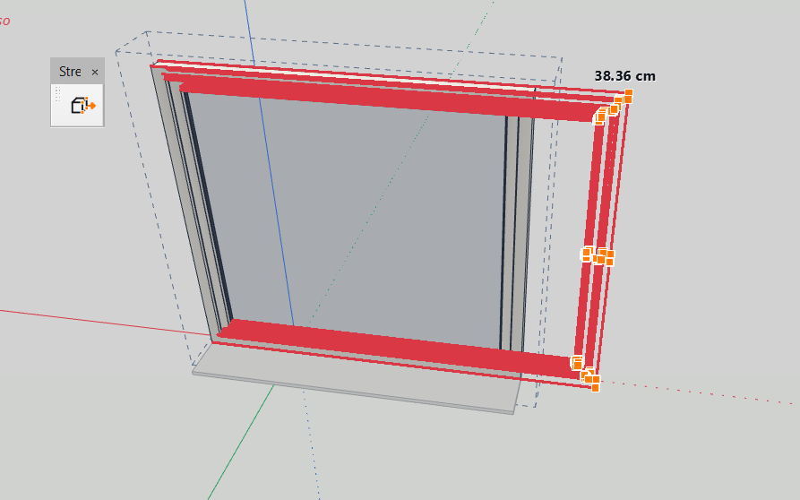

# Stretch Vertices

An extension for [IngeTrazo](https://github.com/ingelibre/ingetrazo): select the
vertices of **part of a group or component** with a window and move them like a
normal Move. The faces and edges that touch the selected vertices follow;
everything else stays where it is (a "stretch").

Works with **nested groups and components** at any depth, and selects *through*
the model, so vertices hidden behind faces are caught too.

## Install

- From the extension manager inside IngeTrazo (once it is listed in the catalog), or
- copy `stretch_vertices.py` into your plugins folder and restart IngeTrazo:
  - Linux: `~/.local/share/ingetrazo/plugins/`
  - Windows: `%APPDATA%\ingetrazo\plugins\`

A **Stretch Vertices** button appears in the toolbar, and the tool is in the
Extensions menu (`Ctrl+Shift+V`).

## How to use

1. Select a group or component and start the tool (button, menu or
   `Ctrl+Shift+V`). It opens the group for you. You can also start the tool and
   click a group, or double-click a group as usual.
2. Drag a window over the vertices you want. Orange squares mark the selection.
   - `Ctrl` adds to the selection
   - `Shift` toggles
   - `Ctrl+Shift` removes
3. Click a **base point** (snaps work), move the mouse and click the
   **destination**.
   - Arrow keys lock an axis.
   - Type a distance (`1.5`) or a vector (`0.2;0;-0.5`) in the Measurements box
     and press Enter.
4. `Esc` cancels the move; a second `Esc` clears the selection.

One move is **one undo step**.

## Good to know

- With a parent group open, the window selects the vertices of the parent **and**
  of every group or component nested inside it.
- A nested component that shares its geometry with other copies is made unique
  when you move it, so only your copy changes. Undo restores the sharing.
- Editing a component changes all its copies when you leave it (`Esc`), like any
  component edit. Use *Make Unique* first to stretch a single copy.
- If a move would produce invalid geometry, IngeTrazo refuses it and says why in
  the status bar.

## License

GPL-3.0-or-later.